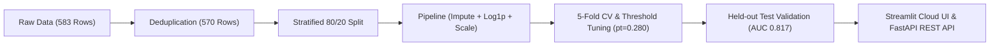

# 🩺 Liver Disease Risk Prediction ML

[](https://www.python.org/)
[](https://creativecommons.org/licenses/by/4.0/)
[]()
[](https://github.com/astral-sh/ruff)
[](https://8gt6vets6xrcmhjpzgkspk.streamlit.app/)
[](SECURITY.md)

An end-to-end clinical machine learning system for early liver disease risk stratification using routine liver function blood panels (UCI ILPD). 

Built with strict zero data leakage, Bayesian-calibrated probabilities, Decision Curve Analysis (DCA), and real-time SHAP explainability.

[🔴 **Launch Live Web App**](https://8gt6vets6xrcmhjpzgkspk.streamlit.app/) • [📖 **API Documentation**](#-fastapi-service) • [🔒 **Security Policy**](SECURITY.md)

---

## ⚡ Key Results (Held-Out Test Set, N=114)

| Metric | Score | Clinical Interpretation |
| :--- | :---: | :--- |
| **ROC-AUC** | **0.8171** `[95% CI: 0.737 – 0.890]` | Strong diagnostic discrimination |
| **Screening Sensitivity** | **98.77%** `[95% CI: 96.2% – 100%]` | Catches nearly all disease cases (tuned threshold $p_t = 0.280$) |
| **Negative Predictive Value** | **95.00%** | High certainty in ruling out healthy patients |
| **Brier Score** | **0.1790** | Highly calibrated probabilistic risk scores |
| **Permutation Test** | **$p < 0.001$** | Confirms true biological signal over random chance |

---

## 🚀 Key Features

* **Zero-Leakage ML Pipeline**: Encapsulated `ColumnTransformer` with median imputation, log1p enzyme transforms, and scaling fitted strictly on training folds.
* **Clinical Decision Utility**: Implemented Decision Curve Analysis (DCA) measuring positive Net Benefit over standard "Screen All" and "Screen None" strategies.
* **Explainable AI (SHAP)**: Global biomarker importance rankings and dynamic, patient-level waterfall plots.
* **Dual Production Delivery**: Interactive **Streamlit Cloud UI** + high-throughput **FastAPI REST Microservice** with OpenAPI docs.
* **Enterprise Security & Privacy**: Ephemeral in-memory inference (zero health data retention) and Pydantic V2 boundary validation.

---

## 🏗️ Pipeline Architecture



---

## 💻 Quickstart

### 1. Installation
```bash
git clone https://github.com/simnexis/liver-disease-prediction.git
cd liver-disease-prediction
pip install -r requirements.txt
```

### 2. Run Tests (40/40 Passing)
```bash
python -m pytest
```

### 3. Launch Local Streamlit Web App
```bash
streamlit run app.py
```
App opens automatically at `http://localhost:8501`.

---

## 🔌 FastAPI Service

Start the production REST microservice:
```bash
uvicorn api:app --reload --port 8000
```
Interactive Swagger documentation available at: **`http://localhost:8000/docs`**

#### Example Single Prediction:
```bash
curl -X POST "http://localhost:8000/api/v1/predict" \
     -H "Content-Type: application/json" \
     -d '{
       "age": 45, "gender": "Male",
       "total_bilirubin": 2.4, "direct_bilirubin": 1.1,
       "alkaline_phosphatase": 230, "alamine_aminotransferase": 68,
       "aspartate_aminotransferase": 85, "total_proteins": 6.2,
       "albumin": 3.1, "albumin_globulin_ratio": 1.0
     }'
```

---

## 🐳 Docker Deployment

Run both the FastAPI API and Streamlit UI in isolated containers:
```bash
docker-compose up --build
```
* **API**: `http://localhost:8000/docs`
* **Web UI**: `http://localhost:8501`

---

## 🔒 Security & Privacy

* **Zero PHI Retention**: All patient inputs are evaluated strictly in ephemeral RAM and never saved to disk or database.
* **Input Validation**: Strict physiological boundary enforcement via Pydantic V2.
* See [`SECURITY.md`](SECURITY.md) for vulnerability disclosure and compliance policies.

---

## 📜 License & Citation

* **Dataset**: UCI Indian Liver Patient Dataset (ILPD), CC BY 4.0.
* **License**: Open-source under [CC BY 4.0](https://creativecommons.org/licenses/by/4.0/).
