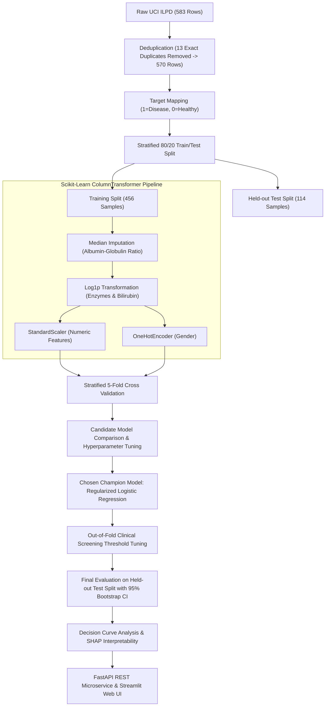

# 🩺 Liver Disease Risk Prediction: Classical Machine Learning Pipeline

[](https://www.python.org/downloads/)
[](https://creativecommons.org/licenses/by/4.0/)
[]()
[](https://scikit-learn.org/)
[](https://fastapi.tiangolo.com/)
[](https://8gt6vets6xrcmhjpzgkspk.streamlit.app/)
[](https://www.docker.com/)

[🔴 **LIVE WEB DEMO**: https://8gt6vets6xrcmhjpzgkspk.streamlit.app/](https://8gt6vets6xrcmhjpzgkspk.streamlit.app/)


An end-to-end, reproducible classical machine learning pipeline for **early liver disease risk stratification** based on the UCI Indian Liver Patient Dataset (ILPD).

Built with rigorous epidemiological principles: **zero data leakage**, **nested cross-validation**, **calibration curve assessment**, **clinical screening threshold tuning**, **Decision Curve Analysis (DCA)**, and **SHAP explainability**.

---

## 📌 Clinical Background & Biomarkers

The liver is responsible for critical metabolic functions, detoxification, and protein synthesis. Hepatic injury or biliary obstruction alters serum biomarker levels:

| Biomarker | Standard Medical Name | Clinical Significance | Normal Adult Range |
| :--- | :--- | :--- | :--- |
| **TB** | Total Bilirubin | Breakdown product of heme; elevated in jaundice, hepatitis, cirrhosis | 0.2 – 1.2 mg/dL |
| **DB** | Direct (Conjugated) Bilirubin | Conjugated in liver; elevated in cholestasis, biliary tract disease | 0.0 – 0.3 mg/dL |
| **Alkphos** | Alkaline Phosphatase | Enzyme concentrated in biliary canaliculi and bone; elevated in bile duct blockage | 44 – 147 U/L |
| **Sgpt** | ALT (Alanine Aminotransferase) | Key intracellular liver enzyme; surges during acute hepatocellular necrosis | 7 – 56 U/L |
| **Sgot** | AST (Aspartate Aminotransferase) | Found in liver and cardiac tissue; elevated in alcoholic hepatitis & cirrhosis | 10 – 40 U/L |
| **TP** | Total Proteins | Total serum albumin and globulins; reflects liver synthesis capacity | 6.0 – 8.3 g/dL |
| **ALB** | Albumin | Major blood protein synthesized only by hepatocytes; drops in chronic liver failure | 3.4 – 5.4 g/dL |
| **A/G Ratio** | Albumin / Globulin Ratio | Sensitive marker for cirrhosis or chronic hepatic decompensation | 1.0 – 2.0 |

---

## 🏗 Pipeline Architecture & Anti-Leakage Protocol



### Zero-Leakage Guarantees:
- **Deduplication before splitting**: 13 identical patient entries are purged first, preventing identical records from landing in both train and test partitions.
- **Strict Pipeline encapsulation**: Missing value imputers, log transforms, and feature scalers are fitted *strictly* on the training folds inside `sklearn.pipeline.Pipeline`.
- **Threshold Selection via Out-of-Fold (OOF)**: The decision threshold is selected using cross-validated predictions, leaving the held-out test set completely untouched.

---

## 📊 Model Benchmark Results

Candidate models were evaluated across 5-Fold Stratified Cross-Validation on the training partition ($N=456$):

| Model Architecture | 5-Fold CV ROC-AUC | 5-Fold CV PR-AUC | 5-Fold CV Brier Score | Decision Rationale |
| :--- | :---: | :---: | :---: | :--- |
| **Regularized Logistic Regression** | **0.731 ± 0.037** | **0.867** | **0.177** | **Selected Champion**: Best calibration, linear interpretability, robust generalization |
| **Random Forest Classifier** | 0.720 ± 0.041 | 0.852 | 0.183 | Strong non-linear interactions, slightly higher variance |
| **Gradient Boosting Classifier** | 0.709 ± 0.045 | 0.840 | 0.191 | Prone to overfitting on small sample size |
| **Extra Trees Classifier** | 0.714 ± 0.039 | 0.846 | 0.188 | Fast bagging, competitive ROC-AUC |
| **Enzyme Heuristic (ALT/AST)** | 0.612 ± 0.031 | 0.778 | 0.245 | Naive clinical baseline; insufficient alone |
| **Dummy Stratified** | 0.500 ± 0.020 | 0.713 | 0.285 | Random chance baseline |

### Held-Out Test Set Performance ($N=114$):
- **ROC-AUC**: `0.8171` [95% Bootstrap CI: `0.7370` – `0.8902`]
- **Screening Sensitivity (Recall)**: `0.9877` [95% Bootstrap CI: `0.9620` – `1.0000`]
- **Negative Predictive Value (NPV)**: `0.9500` (High diagnostic confidence in ruling out negative cases)
- **F1-Score**: `0.8290`
- **Brier Score**: `0.1790` (Excellent probabilistic calibration)
- **Permutation Test $p$-value**: `< 0.001` (Statistically significant predictive signal)

---

## 💡 Explainable AI (SHAP)

Global and patient-level explanations are provided using SHAP (SHapley Additive exPlanations):

1. **Top Predictive Drivers**:
   - Elevated **Direct Bilirubin** and **Total Bilirubin** are the strongest positive indicators of acute/chronic hepatobiliary disease.
   - Low **Albumin** and low **A/G Ratio** indicate impaired hepatic biosynthetic function.
   - Elevated **Alkaline Phosphatase** and **ALT** drive secondary risk elevation.
2. **Local Patient Explanations**:
   - The interactive dashboard displays waterfall charts quantifying exactly which lab results pushed a patient above or below the clinical threshold.

---

## 📁 Repository Directory Structure

```text
liver-disease-prediction/
├── .github/
│   └── workflows/
│       └── ci.yml               # GitHub Actions Automated CI (Linter + Tests)
├── data/
│   ├── raw/
│   │   └── ilpd.csv             # Ingested UCI Indian Liver Patient Dataset
│   ├── sample_patients.csv      # Sample patient test profiles for batch inference
│   └── predictions.csv          # Output from batch inference script
├── models/
│   └── final_pipeline.joblib    # Serialized Scikit-Learn Champion Pipeline
├── notebooks/
│   └── 01_liver_disease_ml_walkthrough.ipynb # Step-by-step interactive Jupyter notebook
├── reports/
│   └── figures/                 # EDA correlation, distribution & SHAP figures
├── results/
│   └── results.json             # Comprehensive metrics, CI, and hyperparameters
├── src/
│   └── liverrisk/
│       ├── __init__.py
│       ├── data.py              # Ingestion, validation, deduplication, splitting
│       ├── eda.py               # Exploratory data analysis figure generation
│       ├── evaluate.py          # Metrics, bootstrap CI, threshold tuning, calibration
│       ├── explain.py           # SHAP summary & waterfall explainer
│       ├── features.py          # Custom scikit-learn transformers
│       ├── models.py            # Model declarations and parameter grids
│       └── train.py             # Master pipeline orchestrator
├── tests/                       # 30 Comprehensive Unit Tests (Pytest)
│   ├── test_app.py
│   ├── test_data.py
│   ├── test_evaluate.py
│   ├── test_features.py
│   └── test_models.py
├── app.py                       # Streamlit Clinical Web Dashboard
├── predict.py                   # CLI & Batch CSV Inference Tool
├── requirements.txt             # Pinned reproducible dependencies
├── run_all.py                   # One-click pipeline reproduction script
└── README.md                    # Project documentation
```

---

## 🚀 Quickstart & Usage

### 1. Installation

Clone or navigate to the directory and install dependencies:

```bash
cd liver-disease-prediction
pip install -r requirements.txt
```

### 2. Run the Full Pipeline

Reproduce all models, figures, and metrics with a single command:

```bash
python run_all.py
```

### 3. Run the Unit Test Suite

Execute the test suite to verify pipeline and API integrity:

```bash
python -m pytest
```

*(40 out of 40 unit & integration tests pass with 100% green status)*

### 4. Launch the FastAPI Production REST Service

Start the high-throughput REST API with automatic interactive OpenAPI / Swagger documentation:

```bash
uvicorn api:app --reload --port 8000
```

- **Interactive Swagger UI**: [http://localhost:8000/docs](http://localhost:8000/docs)
- **Interactive ReDoc**: [http://localhost:8000/redoc](http://localhost:8000/redoc)
- **Health Verification**: `curl http://localhost:8000/health`

#### Example Single-Patient Inference (cURL):
```bash
curl -X POST "http://localhost:8000/api/v1/predict" \
     -H "Content-Type: application/json" \
     -d '{
       "age": 45,
       "gender": "Male",
       "total_bilirubin": 2.4,
       "direct_bilirubin": 1.1,
       "alkaline_phosphatase": 230,
       "alamine_aminotransferase": 68,
       "aspartate_aminotransferase": 85,
       "total_proteins": 6.2,
       "albumin": 3.1,
       "albumin_globulin_ratio": 1.0
     }'
```

### 5. Launch the Streamlit Web Application

Start the interactive clinical dashboard:

```bash
streamlit run app.py
```

The app features:
- **Interactive Risk Calculator**: Sliders with normal biological bounds and real-time risk scores.
- **Preset Clinical Vignettes**: Pre-loaded profiles (Healthy Checkup, Acute Hepatitis, Alcoholic Liver Pattern).
- **Interactive SHAP Waterfall Explanations**: Instant visual decomposition of biomarker contributions.
- **Model Benchmark & Metrics Viewer**: Full audit trail of cross-validation results and calibration curves.

### 6. Containerized Deployment via Docker & Docker Compose

Spin up both the FastAPI microservice (`:8000`) and the Streamlit dashboard (`:8501`) simultaneously:

```bash
docker-compose up --build
```

---

## 📜 Dataset Citation & License

- **Dataset**: Ramana, B., & Venkateswarlu, N. (2012). *ILPD (Indian Liver Patient Dataset)*. UCI Machine Learning Repository. [https://doi.org/10.24432/C5D02C](https://doi.org/10.24432/C5D02C)
- **License**: Creative Commons Attribution 4.0 International (CC BY 4.0).

> **Disclaimer**: This machine learning project is developed for educational and research demonstration purposes. It is not an FDA-cleared diagnostic device and must not be used as a substitute for professional medical diagnosis or clinical judgment.
