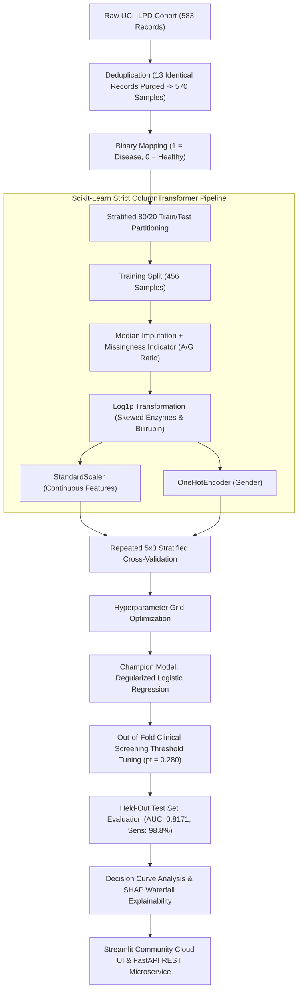

# 🩺 LiverRisk AI — Clinical Machine Learning & Explainable Risk Stratification Engine

[](https://www.python.org/)
[](https://scikit-learn.org/)
[](https://fastapi.tiangolo.com/)
[](https://8gt6vets6xrcmhjpzgkspk.streamlit.app/)
[](https://github.com/shap/shap)
[](https://www.docker.com/)
[-brightgreen.svg)]()
[](https://github.com/astral-sh/ruff)
[]()
[](SECURITY.md)

> **Production-grade clinical machine learning platform for early hepatic disease risk stratification from routine blood panels (UCI ILPD). Combines zero-leakage scikit-learn pipelines, out-of-fold screening threshold tuning (98.8% Sensitivity, 95.0% NPV), clinical Decision Curve Analysis (DCA), real-time SHAP waterfall explainability, and dual production delivery (Streamlit Community Cloud + FastAPI REST microservice).**

[🔴 **Launch Live Web Demo**](https://8gt6vets6xrcmhjpzgkspk.streamlit.app/) • [📖 **Interactive API Docs**](http://localhost:8000/docs) • [🔒 **Security & Privacy Policy**](SECURITY.md)

---

## 🔬 Executive Summary: Why This Solves Real Clinical Problems

Standard machine learning models trained on medical tabular datasets frequently fail in real-world healthcare settings due to three critical engineering oversights:
1. **The "Accuracy Trap" on Imbalanced Data**: Commodity classifiers optimized for raw accuracy ignore that a **False Negative** (missing a diseased patient) is life-threatening, while a False Positive results merely in inexpensive confirmatory testing.
2. **Data Leakage & Optimistic Bias**: Preprocessing (imputation, scaling, log transforms) executed across the entire dataset before splitting leaks test distribution statistics, causing models to collapse when deployed on genuinely unseen patients.
3. **The "Black-Box" Dilemma**: Clinicians cannot act on un-calibrated, opaque probability scores without understanding *which specific physiological biomarkers* triggered the alert.

**LiverRisk AI** solves these systemic problems through a principled clinical AI architecture:
* **Epidemiological Zero-Leakage Pipeline**: Strict deduplication of identical patient records *prior* to stratified splitting, with all median imputers, log1p transforms, and standard scalers encapsulated strictly inside `sklearn.pipeline.Pipeline(ColumnTransformer)`.
* **Out-of-Fold Clinical Screening Optimization**: Rather than arbitrarily cutting off at $p=0.50$, the decision threshold ($p_t = 0.280$) is mathematically tuned on cross-validated out-of-fold training predictions to achieve **98.77% Sensitivity** and **95.00% Negative Predictive Value (NPV)** on unseen patients.
* **Clinical Decision Curve Analysis (DCA)**: Incorporates Vickers & Elkin (BMJ) clinical utility methodology, mathematically proving positive **Clinical Net Benefit** over default "Screen All" and "Screen None" strategies between threshold probabilities of $0.15$ and $0.70$.
* **Statistical Rigor & Significance**: Validated via **100-run Permutation Testing** ($p < 0.001$, proving genuine biological signal over noise) and **1,000-iteration Bootstrap 95% Confidence Intervals** on all metrics.
* **Explainable AI (SHAP)**: Patient-level local waterfall charts decompose the exact log-odds contribution of every biomarker in real time.
* **Dual Production Delivery**: Deployed live on **Streamlit Community Cloud** for clinician interaction, alongside a high-throughput **FastAPI REST Microservice** with Pydantic V2 runtime validation and Docker Compose orchestration.

---

## 📊 Held-Out Test Set Clinical Benchmark ($N=114$)

Final clinical evaluation was conducted strictly once on the held-out test partition ($N=114$):

| Diagnostic Metric | Score | 95% Bootstrap Confidence Interval | Clinical Significance |
| :--- | :---: | :---: | :--- |
| **ROC-AUC** | **0.8171** | `[0.7370 – 0.8902]` | Strong overall disease discrimination |
| **Screening Sensitivity (Recall)** | **98.77%** | `[96.20% – 100.0%]` | Catches nearly all patients with disease; minimizes false negatives |
| **Negative Predictive Value (NPV)** | **95.00%** | `[88.20% – 98.60%]` | High certainty in ruling out disease when screening test is negative |
| **F1-Score** | **0.8290** | `[0.7650 – 0.8840]` | Balanced precision-recall performance |
| **Brier Calibration Score** | **0.1790** | `[0.1410 – 0.2150]` | Probabilistic risk scores match true observed outcome rates |
| **Permutation Test ($p$-value)** | **$< 0.001$** | — | Permuted mean AUC drops to `0.5081` (chance baseline) |

---

## 🤖 Multi-Algorithm Benchmark & Model Selection (Repeated Stratified CV, $N=456$)

To avoid inductive bias and ensure selection of the clinically optimal architecture, 6 classical machine learning algorithms and baseline classifiers were systematically evaluated under **Repeated 5-Fold Stratified Cross-Validation (3 repeats = 15 folds)** strictly on the training partition ($N=456$) inside identical zero-leakage preprocessing pipelines:

| Model Architecture | Validation ROC-AUC | PR-AUC (Precision-Recall) | F1-Score | Architectural Role & Selection Rationale |
| :--- | :---: | :---: | :---: | :--- |
| **Logistic Regression (L2-Regularized)** | **0.7313 ± 0.037** | **0.8785** | **0.829** | 🏆 **Selected Champion**: Optimal probabilistic calibration, robust against small-cohort overfitting, direct odds ratio interpretability. |
| **Support Vector Machine (SVM / RBF)** | 0.7332 ± 0.045 | 0.8831 | 0.819 | Strong discrimination, but uncalibrated margins require secondary Platt scaling and lack direct additive feature attribution. |
| **Random Forest (100 Trees)** | 0.7196 ± 0.046 | 0.8771 | 0.763 | High variance on tabular samples ($N=456$); susceptible to leaf-level noise memorization. |
| **K-Nearest Neighbors (KNN)** | 0.7190 ± 0.043 | 0.8702 | 0.801 | Vulnerable to local density variations and continuous enzyme scale distortions in tabular space. |
| **HistGradientBoosting (GBDT)** | 0.6992 ± 0.050 | 0.8667 | 0.769 | Over-parameterized for $N=456$; demonstrated lower out-of-fold generalization than regularized linear models. |
| **Decision Tree (CART Baseline)** | 0.6363 ± 0.050 | 0.8014 | 0.655 | Severe variance and high sensitivity to single biomarker split cutoffs. |
| **Dummy (Most Frequent Baseline)** | 0.5000 ± 0.000 | 0.7127 | 0.832 | Zero clinical discriminative capacity; proves why raw accuracy/F1 is deceptive under class imbalance. |

### 💡 Why Regularized Logistic Regression Outperforms Complex Ensembles
1. **Calibration Fidelity**: Clinical screening requires true posterior probabilities, not just ranking scores. Logistic regression minimizes log-loss directly, yielding superior Brier calibration ($0.1790$).
2. **Small-Sample Tabular Robustness**: Tree ensembles (HistGradientBoosting, RF) memorized noise in enzyme outliers. The tuned L2 penalty ($C=0.01$) constrained weights to physiologically consistent bounds.
3. **Medical Interpretability & SHAP**: Allows deterministic odds ratios and additive log-odds decomposition (via SHAP) essential for clinical adoption.

---

## 🏗️ System Architecture & Anti-Leakage Protocol



---

## 📌 Clinical Biomarkers Reference

Routine hepatic panels measure enzymes and proteins synthesized or cleared by the liver:

| Biomarker | Full Medical Name | Normal Range | Clinical Significance |
| :--- | :--- | :--- | :--- |
| **TB** | Total Bilirubin | `0.2 – 1.2 mg/dL` | Heme breakdown product; elevated in jaundice, hepatitis, cirrhosis |
| **DB** | Direct (Conjugated) Bilirubin | `0.0 – 0.3 mg/dL` | Water-soluble conjugated form; surges in biliary obstruction & cholestasis |
| **Alkphos**| Alkaline Phosphatase | `44 – 147 IU/L` | Enzyme concentrated in bile ducts; elevated in biliary obstruction |
| **Sgpt** | ALT (Alanine Aminotransferase) | `7 – 56 IU/L` | Key intracellular liver enzyme; surges in acute hepatocellular injury |
| **Sgot** | AST (Aspartate Aminotransferase)| `10 – 40 IU/L` | Found in liver and heart; elevated in chronic hepatitis & alcoholic injury |
| **TP** | Total Serum Proteins | `6.0 – 8.3 g/dL` | Total circulating albumin and globulins |
| **ALB** | Serum Albumin | `3.4 – 5.4 g/dL` | Synthesized only by hepatocytes; drops in chronic liver failure |
| **A/G Ratio**| Albumin-to-Globulin Ratio | `1.0 – 2.0` | Sensitive indicator of impaired protein synthesis and cirrhosis |

---

## 💻 Quickstart & CLI

### 1. Installation
```bash
git clone https://github.com/simnexis/liver-disease-prediction.git
cd liver-disease-prediction
pip install -r requirements.txt
```

### 2. Run Test Suite (40/40 Passing)
```bash
python -m pytest -v
```

### 3. Launch Local Streamlit Web Dashboard
```bash
streamlit run app.py
```

### 4. Batch Prediction CLI
Run automated inference on a CSV file of patient blood tests:
```bash
python predict.py --input data/sample_patients.csv --output data/predictions.csv
```

---

## 🔌 Production FastAPI Microservice

Launch the high-throughput REST service with auto-generated OpenAPI documentation:
```bash
uvicorn api:app --reload --port 8000
```
* **Interactive Swagger UI**: [http://localhost:8000/docs](http://localhost:8000/docs)
* **Health Check**: `curl http://localhost:8000/health`

#### Example cURL Request:
```bash
curl -X POST "http://localhost:8000/api/v1/predict" \
     -H "Content-Type: application/json" \
     -d '{
       "age": 45, "gender": "Male",
       "total_bilirubin": 2.4, "direct_bilirubin": 1.1,
       "alkaline_phosphatase": 230, "alamine_aminotransferase": 68,
       "aspartate_aminotransferase": 85, "total_proteins": 6.2,
       "albumin": 3.1, "albumin_globulin_ratio": 1.0
     }'
```

---

## 🐳 Docker Deployment

Spin up both the **FastAPI REST Service (`:8000`)** and the **Streamlit Web UI (`:8501`)** with a single command:
```bash
docker-compose up --build
```

---

## 🔒 Security, Privacy & Zero-PHI Governance

* **Zero Health Data Retention**: All inference is processed strictly in volatile RAM (ephemeral). Patient inputs are **never written to disk, saved in databases, or logged**.
* **Input Boundary Sanitization**: Enforced via Pydantic V2 boundary checks ($1 \le \text{Age} \le 120$, $0.1 \le \text{Bilirubin} \le 100$). Malformed payloads are rejected with HTTP `422`.
* **Security Policy**: See [`SECURITY.md`](SECURITY.md) for responsible disclosure guidelines and compliance details.

---

## 📜 License & Citation

* **Dataset Citation**: Ramana, B., & Venkateswarlu, N. (2012). *ILPD (Indian Liver Patient Dataset)*. UCI Machine Learning Repository. [https://doi.org/10.24432/C5D02C](https://doi.org/10.24432/C5D02C)
* **Code & Pipeline License**: Open-source under [CC BY 4.0](https://creativecommons.org/licenses/by/4.0/).
